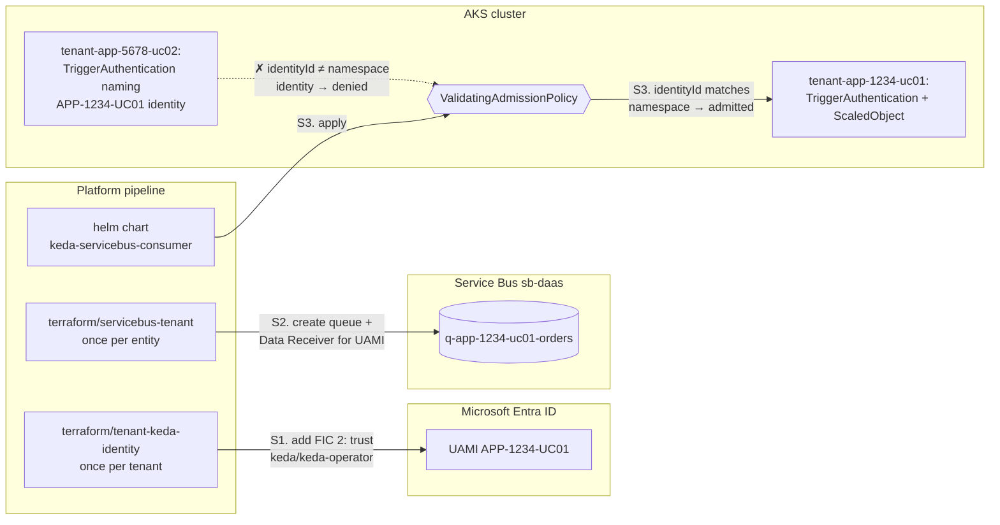
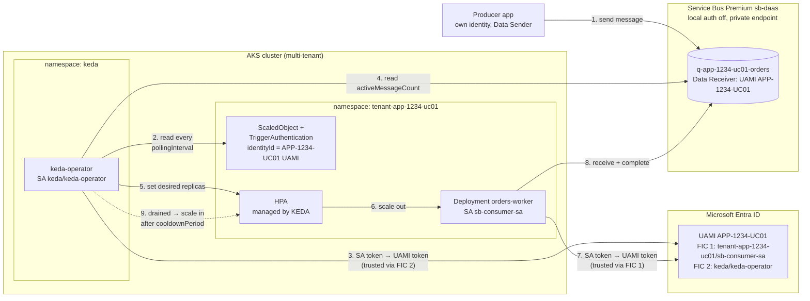
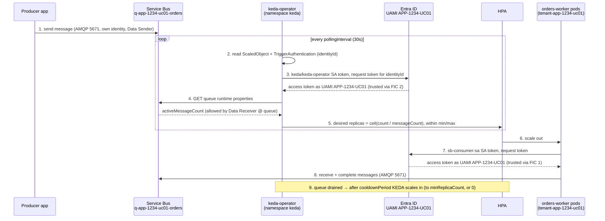

# KEDA + Azure Service Bus on AKS (multi-tenant, shared landing zone)

This module onboards tenants onto a **shared Azure Service Bus Premium
namespace** (e.g. `sb-daas`) in the landing zone and makes **KEDA scale
their AKS workloads on Service Bus backlog**, with isolation between
tenants enforced at every layer:

| Layer | Isolation mechanism | Implemented in |
|---|---|---|
| Azure data plane | Entra RBAC at the exact queue / topic / subscription scope; SAS disabled on the namespace | `terraform/servicebus-tenant` |
| Identity | One user-assigned managed identity per tenant, federated to the tenant's ServiceAccount (onboarding) and to the KEDA operator, so KEDA polls as the tenant | onboarding + `terraform/tenant-keda-identity` |
| Kubernetes API | Admission policy binds each tenant namespace to its own identity, entity prefix and scaling caps | `platform/admission` |
| Network | Default-deny NetworkPolicy; egress only to DNS, the Service Bus private endpoint and Entra ID | `charts/keda-servicebus-consumer` |
| Registry | PostgreSQL constraints for naming, ownership, scopes, caps, status and audit | `registry` |

`docs/design-review.md` records how this implementation lines up with the
*Service Registry Design for Azure Service Bus and KEDA Autoscaling*
document, and what changed on each side.

**Ownership split**:

| Provisioned elsewhere (inputs to this module) | Created by this module |
|---|---|
| AKS cluster (OIDC issuer, workload identity enabled; KEDA self-managed in the `keda` namespace) | Tenant queue, or topic + `sub-<consumer>` subscriptions (Terraform, per entity) |
| Shared Service Bus Premium namespace, private endpoint, `disableLocalAuth=true` (landing zone) | Data-plane role assignments at the exact entity scope (Terraform, per entity) |
| Tenant AKS namespace, labeled/annotated per the onboarding contract below | Federated credential that lets KEDA poll as the tenant identity (Terraform, once per tenant) |
| Tenant workload identity: UAMI, federated credential for the workload ServiceAccount, the ServiceAccount itself | KEDA `TriggerAuthentication` + `ScaledObject`, `NetworkPolicy`, placeholder Deployment (Helm) |
| | Cluster-wide admission policy (platform team, once per cluster) |
| | Registry tables, validation and audit (PostgreSQL migration) |

Cluster prerequisites:

```bash
az aks update -g <rg> -n <aks-name> --enable-oidc-issuer --enable-workload-identity

# Self-managed KEDA in its own namespace (do NOT also enable the AKS KEDA
# add-on, which is pinned to kube-system). The workload-identity flags label
# the keda-operator ServiceAccount so the webhook injects a federated token.
# KEDA's own identity gets NO Service Bus roles: tenants' TriggerAuthentications
# make KEDA poll as each tenant's identity instead.
helm repo add kedacore https://kedacore.github.io/charts
helm upgrade --install keda kedacore/keda -n keda --create-namespace \
  --set podIdentity.azureWorkload.enabled=true \
  --set podIdentity.azureWorkload.clientId=<KEDA operator identity client ID> \
  --set podIdentity.azureWorkload.tenantId=<Entra tenant ID>
```

**Tenant ID.** A tenant is one application use case, identified as
`APP-<number>-UC<nn>` (e.g. `APP-1234-UC01`). Each tenant ID is its own
isolation unit: one managed identity, one Kubernetes namespace, its own
entities. Two use cases of the same application (`UC01`, `UC02`) are
isolated from each other just like two different applications. The ID is
kept in canonical uppercase wherever it is an ID (Terraform input, Helm
`tenant.id`, Namespace label, registry). Inside resource names it is
lowercased, because Service Bus names are case-insensitive and Kubernetes
names must be lowercase:

| Resource | Pattern | Example |
|---|---|---|
| Queue | `q-<tenantid>-<purpose>` | `q-app-1234-uc01-orders` |
| Topic | `t-<tenantid>-<purpose>` | `t-app-5678-uc02-events` |
| Subscription | `sub-<consumer>` | `sub-billing-worker` |
| Kubernetes namespace (suggested) | `tenant-<tenantid>` | `tenant-app-1234-uc01` |

The fixed `APP-<digits>-UC<2 digits>` structure means one tenant's name
prefix can never be a prefix of another tenant's names (`q-app-1234-uc01-`
doesn't match `q-app-12345-…` or `q-app-1234-uc011…`). Prefix-based ownership
checks are therefore exact.

**Tenant onboarding contract.** Each tenant Namespace must carry, set by the
platform (tenants must not be able to edit Namespace objects):

```yaml
metadata:
  labels:
    platform.io/tenant: APP-1234-UC01                            # canonical tenant ID
  annotations:
    platform.io/workload-identity-client-id: <tenant UAMI client ID>
```

---

## 1. Architecture

### 1.1 Setup flow (S1–S3)

Runs during onboarding: S1 once per tenant, S2 once per queue/topic, S3 per
Helm release.



| Step | From → To | What passes | What is checked |
|---|---|---|---|
| S1 | `terraform/tenant-keda-identity` → Entra ID | Federated credential on the tenant UAMI: issuer = AKS OIDC issuer, subject = `system:serviceaccount:keda:keda-operator` | Only that ServiceAccount on that cluster can later get tokens for this UAMI |
| S2 | `terraform/servicebus-tenant` → Service Bus | Queue `q-app-1234-uc01-orders`; role assignment Data Receiver for the tenant UAMI at `/queues/q-app-1234-uc01-orders` | Name and grants validated in Terraform; scope is the single queue |
| S3 | Helm → API server → admission policy | `TriggerAuthentication` (`identityId` = tenant client ID) + `ScaledObject` | `identityId` must equal the Namespace annotation `platform.io/workload-identity-client-id`; queue prefix must match the Namespace label `platform.io/tenant`. Tenant APP-5678-UC02 naming APP-1234-UC01's identity is denied |

### 1.2 Runtime flow (1–9)

Repeats for every message and every polling interval. Tenant APP-5678-UC02
follows the same steps with its own identity, namespace and subscription.



| Step | From → To | What passes (context) | Protocol / check |
|---|---|---|---|
| 1 | Producer → queue | Message, sent with the producer's own Entra token | AMQP over TLS 5671 via private endpoint; Data Sender on the queue |
| 2 | keda-operator → Kubernetes API | `ScaledObject` (queue name, `messageCount`, min/max) and its `TriggerAuthentication` (`identityId`) | Every `pollingInterval` (30s); objects already passed the admission policy (S3) |
| 3 | keda-operator → Entra ID | Projected `keda/keda-operator` ServiceAccount token (audience `api://AzureADTokenExchange`) + `identityId` → access token **as UAMI APP-1234-UC01** | Entra matches issuer + subject against FIC 2 (S1) |
| 4 | keda-operator → Service Bus | `GET` queue runtime properties with that token → `activeMessageCount` | HTTPS 443 via private endpoint; authorized by Data Receiver at queue scope (S2), so no other tenant's queue is readable |
| 5 | keda-operator → HPA | External metric; desired replicas = `ceil(activeMessageCount / messageCount)`, clamped to min/max. From 0 replicas KEDA activates the Deployment directly once count > `activationMessageCount` | Caps enforced by the chart and admission policy |
| 6 | HPA → Deployment | Replica count | Kubernetes scaling |
| 7 | Worker pod → Entra ID | Projected `tenant-app-1234-uc01/sb-consumer-sa` token (injected by the workload identity webhook) → access token as the same UAMI | Entra matches FIC 1 (created by onboarding) |
| 8 | Worker pod → queue | Receive + complete messages with that token | AMQP over TLS 5671 via private endpoint; Data Receiver at queue scope |
| 9 | keda-operator → HPA | Queue drained: KEDA keeps replicas for `cooldownPeriod` (300s), then scales in to `minReplicaCount` (or 0) | Same polling loop as steps 2–5 |

### 1.3 Runtime sequence

The same steps 1–9 in time order:



### How the KEDA authentication path works (default: KEDA polls as the tenant)

KEDA's `azure-workload` provider **always authenticates as the
keda-operator ServiceAccount**. It does not borrow the scaled
Deployment's identity. `identityOwner: workload` is an AWS-only field and
is ignored for Azure. The default model makes KEDA poll each tenant's
entities as **that tenant's own identity**:

1. Each tenant UAMI gets a **second federated credential** whose subject is
   `system:serviceaccount:keda:keda-operator`, created once per tenant by
   `terraform/tenant-keda-identity`. It is not created per queue: an
   identity can hold only one credential per issuer and subject, so a
   per-entity module would fail on the tenant's second entity.
2. The tenant's `TriggerAuthentication` sets
   `podIdentity.identityId: <tenant UAMI client ID>`, so KEDA requests a
   token for *that* identity, which can only read the tenant's own entity.
3. Because the KEDA operator can now act as every tenant's identity, the
   **admission policy** (`platform/admission`) is what prevents tenant B
   from writing a `TriggerAuthentication` that names tenant A's client ID.
   Client IDs are not secrets, so without this policy the isolation does
   not hold.

The KEDA operator's own identity should have **no** Service Bus access
(KEDA docs, "Case 2"). A `TriggerAuthentication` without `identityId` then
fails closed instead of silently using a broadly scoped identity, and the
admission policy rejects it anyway.

---

## 2. Networking

### Option A: private endpoint (landing-zone default)

- Namespace has public network access disabled and a private endpoint in
  a subnet reachable from the AKS VNet. `privatelink.servicebus.windows.net`
  private DNS zone linked to the AKS VNet.
- NSG / firewall: egress from AKS to the private endpoint on **5671/tcp**
  (AMQP over TLS) and **443/tcp** (AMQP over WebSockets, and the HTTPS
  management API KEDA uses for queue depth). Plain AMQP (5672) is not used.
- **Microsoft Entra ID egress is also required.** Workload identity
  exchanges the federated token at `login.microsoftonline.com:443`. With
  egress locked down to the private endpoint only, pods and KEDA fail to
  authenticate even though Service Bus is reachable. Allow it through Azure
  Firewall (`AzureActiveDirectory` service tag / FQDN rule).
- **The KEDA operator (`keda` namespace) needs the same egress** to the private
  endpoint and to Entra ID, not just the tenant namespaces.

### Option B: public endpoint + Entra-only auth

Only if a private endpoint is not available yet: keep public access but
with `disableLocalAuth=true`, an IP firewall on the namespace, and
`networkPolicy.allowPublicServiceBusEgress=true` in the chart.

### NetworkPolicy (per tenant namespace, from the chart)

- Default deny, ingress and egress.
- DNS only to `kube-system/kube-dns`, not port 53 on every pod in the cluster.
- Service Bus egress on 5671/443 to `networkPolicy.serviceBusEgressCIDRs`
  (the private endpoint). Rendering fails if it is empty and public egress
  isn't explicitly allowed.
- Entra ID egress on 443 to public addresses only (RFC1918/CGNAT ranges
  excluded, so this can't be used to reach other tenants' pods). Kubernetes
  NetworkPolicy can't match FQDNs; narrow it with Azure Firewall or a
  Cilium FQDN policy.

---

## 3. RBAC (least privilege)

No connection strings or SAS keys anywhere. The namespace has
`disableLocalAuth=true`, enforced by Azure Policy in the landing zone, and the
admission policy rejects secret-based KEDA auth.

| Grant (`access_grants` in Terraform) | Role | Scope |
|---|---|---|
| queue, sender | Azure Service Bus Data Sender | `/queues/q-<tenantid>-<purpose>` |
| queue, receiver | Azure Service Bus Data Receiver | `/queues/q-<tenantid>-<purpose>` |
| topic, sender | Azure Service Bus Data Sender | `/topics/t-<tenantid>-<purpose>` |
| topic, receiver | Azure Service Bus Data Receiver | `/topics/t-<tenantid>-<purpose>/subscriptions/sub-<consumer>` |

- `sender_receiver` creates two separate assignments, never Data Owner.
- **Data Receiver is never granted at topic scope**: that would allow
  receiving from every subscription on the topic, including other
  consumers'.
- KEDA reads the active message count through the management API using
  the receiving identity; Data Receiver at the entity scope includes the
  entity read action this needs. Confirm it with the smoke test
  (`scripts/verify-keda-scaling.sh`) on first rollout.
- Producer and consumer workloads on the same entity get separate grants,
  each for its own identity.

---

## 4. How KEDA drives scale-out

1. A `ScaledObject` points at the tenant Deployment and declares an
   `azure-servicebus` trigger with `namespace: sb-daas` (**short name**:
   KEDA appends `.servicebus.windows.net` itself, so an FQDN here produces
   `sb-daas.servicebus.windows.net.servicebus.windows.net`) and either
   `queueName`, or `topicName` + `subscriptionName`.
2. KEDA creates an HPA with an external metric. Every `pollingInterval`
   (default 30s, minimum 15s by policy) it reads the entity's
   `activeMessageCount` as the tenant identity.
3. Desired replicas = `ceil(activeMessageCount / messageCount)`, clamped to
   `[minReplicaCount, maxReplicaCount]`. `maxReplicaCount` must be set
   explicitly (KEDA defaults to 100) and is capped by policy.
4. With `minReplicaCount: 0`, KEDA activates the Deployment once backlog
   exceeds `activationMessageCount`, and scales back to zero after
   `cooldownPeriod`.
5. Dead-lettered messages are not counted. Monitor DLQ depth separately.
6. The application consumes messages with the Service Bus SDK and
   `DefaultAzureCredential`, using its own ServiceAccount federation. KEDA
   never receives messages.

---

## 5. Guardrails

The same rules are enforced in four places so that no single path can
bypass them:

| Rule | Terraform | Helm | Admission | Registry |
|---|---|---|---|---|
| Namespace on approved list | ✓ | ✓ (short name) | ✓ | ✓ (FK; Premium + local auth disabled) |
| `q-<tenantid>-<purpose>` / `t-<tenantid>-<purpose>` / `sub-<consumer>` | generated | ✓ | ✓ (tenant ID from Namespace label) | generated |
| Tenant ID is canonical `APP-<number>-UC<nn>` (makes prefix checks exact) | ✓ | ✓ | ✓ (label format) | ✓ |
| Topic receivers need a subscription; queues have none | ✓ | ✓ | ✓ | ✓ |
| RBAC scope is the exact entity, computed rather than supplied | ✓ | n/a | n/a | ✓ |
| `identityId` = the namespace's onboarded identity | n/a | required value | ✓ | stored |
| No SAS / connection strings / regex / ClusterTriggerAuthentication | n/a | n/a | ✓ | n/a |
| `min ≤ max ≤ cap`, `messageCount` range, polling floor | n/a | ✓ | ✓ | ✓ |
| Approved max size, lock duration 5–300s | ✓ | n/a | n/a | ✓ |
| Change → audit + re-queue for reconciliation; status state machine | n/a | n/a | n/a | ✓ |

---

## 6. Repo layout

```
service_bus_keda/
├── .github/workflows/                    # offline checks (PRs) + live smoke test (manual)
├── README.md
├── docs/design-review.md                 # design document vs implementation
├── terraform/tenant-keda-identity/       # once per tenant: KEDA trust on the tenant identity
│   └── tests/keda_identity.tftest.hcl    # offline tests (mock provider)
├── terraform/servicebus-tenant/          # once per entity: queue/topic + exact-scope RBAC
│   └── tests/guardrails.tftest.hcl       # offline tests (mock provider)
├── charts/keda-servicebus-consumer/      # per-tenant KEDA objects, NetworkPolicy, placeholder Deployment
│   ├── values.yaml / values.schema.json
│   ├── values-tenant-a.yaml              # queue example (APP-1234-UC01)
│   └── values-tenant-b.yaml              # topic-subscription example (APP-5678-UC02)
├── platform/admission/
│   ├── keda-tenant-guardrails.yaml       # ValidatingAdmissionPolicy (platform-owned)
│   └── policytest/                       # CEL tests against rendered chart + attack cases
├── registry/
│   ├── 001_servicebus_keda.sql           # PostgreSQL registry extension
│   └── tests/                            # SQL tests
└── scripts/                              # live end-to-end verification
```

---

## 7. Deploying a tenant

```bash
# 0. Once per cluster (platform team)
kubectl apply -f platform/admission/keda-tenant-guardrails.yaml

# 1. Once per tenant: let KEDA poll as the tenant identity
cd terraform/tenant-keda-identity
cat > app-1234-uc01.tfvars <<'EOF'
tenant_id                     = "APP-1234-UC01"
workload_identity_resource_id = "/subscriptions/<sub>/resourceGroups/<rg>/providers/Microsoft.ManagedIdentity/userAssignedIdentities/<app-1234-uc01-uami>"
aks_oidc_issuer_url           = "<az aks show --query oidcIssuerProfile.issuerUrl>"
EOF
terraform init && terraform apply -var-file=app-1234-uc01.tfvars
terraform output client_id            # -> Helm identity.clientId
terraform output namespace_metadata   # -> label/annotation onboarding sets on the Namespace
terraform output principal_id         # -> access_grants below

# 2. Once per entity: queue/topic + exact-scope RBAC
cd ../servicebus-tenant
cat > app-1234-uc01-orders.tfvars <<'EOF'
tenant_id                         = "APP-1234-UC01"
purpose                           = "orders"
entity_type                       = "queue"
servicebus_namespace_id           = "/subscriptions/<sub>/resourceGroups/<rg>/providers/Microsoft.ServiceBus/namespaces/sb-daas"
approved_servicebus_namespace_ids = ["/subscriptions/<sub>/resourceGroups/<rg>/providers/Microsoft.ServiceBus/namespaces/sb-daas"]
lock_duration_seconds             = 60
access_grants = {
  # The tenant identity must hold the receive grant: KEDA reads queue
  # depth as this identity.
  worker = { principal_id = "<principal_id output from step 1>", access_mode = "receiver" }
}
EOF
terraform init && terraform apply -var-file=app-1234-uc01-orders.tfvars

# 3. KEDA objects (values from `terraform output keda_trigger_metadata`)
cd ../../charts/keda-servicebus-consumer
helm upgrade --install app-1234-uc01-orders . -f values-tenant-a.yaml

# 4. Live verification
cd ../../scripts
./verify-keda-scaling.sh -n tenant-app-1234-uc01 -d orders-worker -s sb-daas.servicebus.windows.net -q q-app-1234-uc01-orders -c 20
```

## 8. Tests and CI

| Check | Local command | CI |
|---|---|---|
| Terraform guardrails | `cd terraform/<module> && terraform init -backend=false && terraform test` (both modules) | `keda-servicebus-checks.yml` |
| Chart lint | `helm lint charts/keda-servicebus-consumer -f charts/keda-servicebus-consumer/values-tenant-a.yaml` | same |
| Admission policy | `cd platform/admission/policytest && go test ./...` | same |
| Registry | `psql -v ON_ERROR_STOP=1 -f registry/001_servicebus_keda.sql -f registry/tests/001_servicebus_keda_test.sql` (scratch DB) | same, Postgres 16 service |
| Live end-to-end | `scripts/verify-keda-scaling.sh` | `verify-keda-servicebus.yml` (manual, OIDC) |

The admission-policy tests evaluate the policy's CEL with cel-go and the
same strings extension Kubernetes uses. They don't replace a dry run against
a real API server (`kubectl apply --dry-run=server`) on the target cluster
version.
